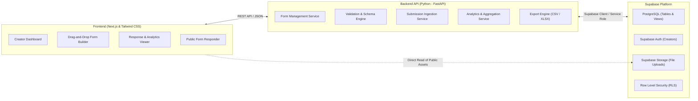

# Centralized Form Builder & Response Platform
## Architecture Blueprint & Comprehensive Development Plan

---

## 1. Project Overview & Technology Stack

The objective is to build a centralized, modular form-building and response-collection platform (similar to Google Forms). The system enables authenticated creators to compose, customize, and share dynamic forms, while allowing respondents to fill them out seamlessly across devices. Submissions are captured, structured, and presented through real-time analytics, dynamic data grids, and data export pipelines.

### Core Stack
- **Frontend:** Next.js (App Router, React, TypeScript), Tailwind CSS
- **Backend:** Python (FastAPI, Pydantic, Asynchronous runtime)
- **Database, Auth & Storage:** Supabase (PostgreSQL, Supabase Auth, Row Level Security, Supabase Storage)

---

## 2. High-Level System Architecture

### Architectural Layer Responsibilities
1. **Presentation Layer (Next.js):** 
   - Server-side renders (SSR) public forms for instant initial load times and mobile compatibility.
   - Client components handle reactive drag-and-drop interactions, live form previews, and chart visualizations.
2. **Business Logic Layer (Python / FastAPI):**
   - Validates question and form configurations using structured Pydantic models.
   - Enforces server-side validation on submitted responses to guarantee data integrity.
   - Aggregates analytical metrics and streams data exports (CSV/Excel) efficiently.
3. **Data Layer (Supabase):**
   - Relational database management with PostgreSQL.
   - Role-based data access enforced through Row Level Security (RLS).
   - Secure storage buckets for form banners and respondent file attachments.

---

## 3. Data Model & Conceptual Schema

The platform utilizes a normalized relational structure paired with flexible JSON columns for custom question attributes and answers:

- **`profiles`:** User account data mapped directly to Supabase Auth UUIDs.
- **`forms`:** Form metadata, status flags, customization settings, and owner foreign keys.
- **`form_questions`:** Dynamic question definitions, ordering indexes, validation rules (JSONB), and options (JSONB).
- **`form_responses`:** Submission envelopes tracking timestamps and respondent metadata.
- **`form_answers`:** Individual question answers tied to responses and questions.

---

## 4. Phase-by-Phase Detailed Implementation Plans

Each phase has a dedicated, self-contained implementation plan detailing the concepts introduced, step-by-step technical procedures, workflows, and verification criteria:

| Phase | Plan Document | Key Concepts Introduced |
|---|---|---|
| **Phase 1** | [PHASE_1_SETUP_AND_FOUNDATION.md](file:///a:/Projects/hypervision-form/docs/phases/PHASE_1_SETUP_AND_FOUNDATION.md) | Monorepo layout, PostgreSQL JSONB modeling, Supabase service vs. anon roles, Python ASGI, Next.js App Router |
| **Phase 2** | [PHASE_2_AUTH_AND_DASHBOARD.md](file:///a:/Projects/hypervision-form/docs/phases/PHASE_2_AUTH_AND_DASHBOARD.md) | Stateless JWT authentication, OAuth 2.0 federation, Next.js edge middleware, PostgreSQL RLS tenant isolation, Optimistic UI |
| **Phase 3** | [PHASE_3_FORM_BUILDER.md](file:///a:/Projects/hypervision-form/docs/phases/PHASE_3_FORM_BUILDER.md) | Schema-driven UI generation, Unidirectional state stores, Debounced autosave, Drag-and-drop pointer mechanics, Polymorphic components |
| **Phase 4** | [PHASE_4_PUBLIC_VIEWER_SUBMISSION.md](file:///a:/Projects/hypervision-form/docs/phases/PHASE_4_PUBLIC_VIEWER_SUBMISSION.md) | Server-Side Rendering (SSR), Dual-layer validation (Defense in Depth), Direct-to-storage file ingestion, Form lifecycle gatekeeping, Idempotency |
| **Phase 5** | [PHASE_5_RESPONSES_AND_ANALYTICS.md](file:///a:/Projects/hypervision-form/docs/phases/PHASE_5_RESPONSES_AND_ANALYTICS.md) | Relational aggregations & statistics, Virtualized data grids, Information hierarchy visualization, Streaming data exports |
| **Phase 6** | [PHASE_6_ADVANCED_FEATURES.md](file:///a:/Projects/hypervision-form/docs/phases/PHASE_6_ADVANCED_FEATURES.md) | Directed Acyclic Graphs (DAG) for skip logic, CSS custom properties at runtime, Supabase Realtime WebSockets, Background notification tasks |
| **Phase 7** | [PHASE_7_SECURITY_TESTING_DEPLOYMENT.md](file:///a:/Projects/hypervision-form/docs/phases/PHASE_7_SECURITY_TESTING_DEPLOYMENT.md) | Zero Trust RLS audits, OWASP Top 10 mitigation, Testing Pyramid (Unit, Integration, E2E), Docker containerization, Edge distribution |

---

## 5. Milestone Tracking & Verification Checklist

| Milestone | Deliverables | Verification Criteria |
|---|---|---|
| **M1: Foundation** | Project scaffolding, DB schema, API base | Database tables online, backend connected to Supabase, Next.js initialized. |
| **M2: Auth & Dashboard** | Sign-in/up, protected routes, form list | Creator can log in, view their dashboard, and initiate a new form. |
| **M3: Builder MVP** | Question canvas, core question types, autosave | Creator can add, reorder, edit fields, and verify data persists in DB. |
| **M4: Public Submission** | Public form route, validation, submission pipeline | Respondent can open public link, fill out fields, and store answer payload. |
| **M5: Response Grid & Export** | Table view, CSV/XLSX export, single response view | Creator can view all submissions in a grid and download an export file. |
| **M6: Visual Analytics** | Summary charts, rating averages, file questions | Summary tab renders visual charts for choices and handles file attachments. |
| **M7: Polish & Deploy** | Rate limits, RLS audit, production deployment | End-to-end system live in production with verified security policies. |
