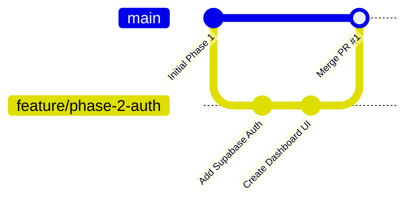

# Git Guide for Hypervision Form Platform

A beginner-friendly and practical reference guide for version control workflows when developing the **Hypervision Form** project.

---

## 1. Initial Setup & Configuration

Before making commits, configure your Git identity on your machine. This associates your name and email with your contributions.

```bash
# Set your global username and email (one-time setup)
git config --global user.name "Your Name"
git config --global user.email "your.email@example.com"

# Check your active Git configuration
git config --list
```

### Checking Repository Status
Run `git status` frequently to see which branch you are on, which files were changed, and which files are staged for commit:

```bash
git status
```

---

## 2. Branching: How to Create and Switch Branches

Always develop new features, bug fixes, or documentation updates on an isolated **branch** rather than directly on `main`.



### 2.1 Branch Naming Conventions
Use descriptive, hyphenated names with a prefix:
- `feature/<name>` (e.g., `feature/phase-2-auth`, `feature/rating-scale-input`)
- `fix/<issue>` (e.g., `fix/submission-validation`, `fix/tailwind-colors`)
- `docs/<topic>` (e.g., `docs/api-endpoints`, `docs/setup-guide`)

### 2.2 Branch Commands
```bash
# 1. Ensure your local main branch is up-to-date
git checkout main
git pull origin main

# 2. Create and switch to a new branch in one command
git checkout -b feature/phase-2-auth

# (Modern alternative syntax)
git switch -c feature/phase-2-auth

# List all local branches (the active branch is marked with an asterisk *)
git branch

# Switch back to an existing branch
git checkout feature/phase-2-auth
# or
git switch feature/phase-2-auth
```

---

## 3. Staging and Committing: How to Commit Changes

A commit records a snapshot of your staged changes with an explanatory message.

### 3.1 Step-by-Step Commit Workflow

1. **Review your changes:**
   ```bash
   # See modified and untracked files
   git status

   # Inspect exact line-by-line diffs
   git diff
   ```

2. **Stage the files you want to include:**
   ```bash
   # Stage a specific file
   git add backend/app/main.py

   # Stage a specific folder
   git add frontend/src/components/

   # Stage all modified and new files (excluding those in .gitignore)
   git add .
   ```

3. **Create the commit with a descriptive message:**
   ```bash
   git commit -m "feat(backend): add authentication dependency and jwt verification"
   ```

### 3.2 Writing Good Commit Messages (Conventional Commits)
Follow the `<type>(<scope>): <summary>` format:
- `feat`: A new feature (e.g., `feat(frontend): implement drag and drop question card`)
- `fix`: A bug fix (e.g., `fix(api): handle missing option ids in choice validation`)
- `docs`: Documentation updates (e.g., `docs: add phase 2 detailed implementation plan`)
- `refactor`: Code reorganization without changing features or fixing bugs
- `chore`: Tooling, dependencies, or configuration changes

### 3.3 Viewing History
```bash
# View recent commits in compact single-line format
git log --oneline -n 5

# View commit history with graphical branch paths
git log --oneline --graph --all
```

---

## 4. Pushing Changes to Remote

After committing locally, push your branch to GitHub (or your Git remote host).

```bash
# First push of a new branch (sets upstream tracking)
git push -u origin feature/phase-2-auth

# Subsequent pushes on the same branch
git push
```

---

## 5. Pull Requests (PR): How to Create and Manage a PR

A **Pull Request (PR)** notifies your teammates (or repository maintainers) that your branch is ready to be reviewed and merged into `main`.

### 5.1 Creating a PR on GitHub (Web Interface)
1. Push your branch to the remote repository (`git push -u origin <branch-name>`).
2. Open your repository page on [GitHub](https://github.com).
3. A yellow banner will appear: **"Compare & pull request"**. Click it.
   *(If not visible, navigate to the **Pull requests** tab and click **New pull request**).*
4. Select the base branch (`main`) and compare branch (`feature/phase-2-auth`).
5. Provide a clear **Title** and **Description**:
   - What changed?
   - How was it tested? (e.g., `Ran npm run build and verified health endpoint`).
   - Link related issues or milestones.
6. Click **Create pull request**.

### 5.2 Updating a PR After Feedback
If changes are requested during review, do **not** close the PR or create a new branch. Simply:
1. Make the requested edits locally.
2. Stage and commit them:
   ```bash
   git add .
   git commit -m "fix(review): address review feedback on validation schema"
   ```
3. Push to your branch:
   ```bash
   git push
   ```
4. The open Pull Request on GitHub will automatically update with your new commit.

---

## 6. Keeping Your Branch Updated & Merging

When other changes are merged into `main`, sync your feature branch to prevent merge conflicts.

```bash
# 1. Switch to main and pull the latest changes
git checkout main
git pull origin main

# 2. Switch back to your feature branch
git checkout feature/phase-2-auth

# 3. Merge main into your feature branch
git merge main

# 4. Resolve any conflicts if prompted, stage resolved files, and commit:
git commit -m "merge: sync branch with main"
```

### Cleaning Up After PR is Merged
Once your PR has been merged into `main` on GitHub:

```bash
# Switch to main and update it
git checkout main
git pull origin main

# Delete your local feature branch (it is already in main)
git branch -d feature/phase-2-auth

# Prune remote branch references that no longer exist on GitHub
git remote prune origin
```

---

## 7. Undoing & Fixing Common Mistakes

| Scenario | Command |
|---|---|
| **Unstage a file accidentally added** | `git restore --staged <file>` |
| **Discard uncommitted edits in a file** | `git restore <file>` |
| **Discard all uncommitted local edits** | `git restore .` |
| **Fix the last commit message** | `git commit --amend -m "new message"` |
| **Temporarily shelve dirty uncommitted work** | `git stash` |
| **Restore previously shelved work** | `git stash pop` |

> [!CAUTION]
> Avoid running `git push --force` or `git reset --hard` on shared branches like `main`. It overwrites commit history on the server and can cause lost work for collaborators.

---

## 8. Hypervision Form Repository Checklist

Before pushing code or opening a PR in this project:

1. **Verify No Secrets Staged:**
   - Double check `git status`. Ensure `.env` or `.env.local` files containing real API keys or service role secrets are never staged. (They should be ignored by `.gitignore`).
2. **Verify Frontend Build:**
   ```bash
   npm run build --prefix frontend
   ```
   Confirm that TypeScript checks pass and the Next.js bundle compiles with 0 errors.
3. **Verify Backend Imports:**
   ```bash
   backend\.venv\Scripts\python.exe -c "from app.main import app; print(app.title)"
   ```
   Confirm that all Python routes and Pydantic schemas import cleanly.

