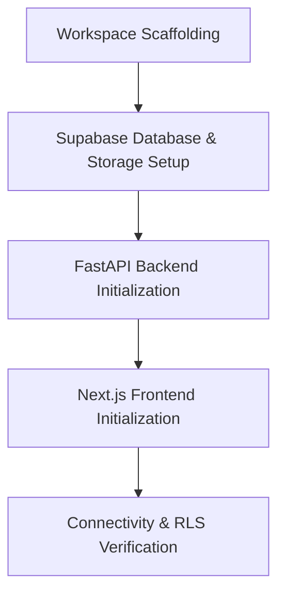

# Phase 1: Project Setup, Infrastructure & Database Design

---

## 1. Concepts Introduced in This Phase

### 1.1 Monorepo vs. Polyrepo for Full-Stack Systems
- **Concept:** Structuring a repository containing a Python backend and a JavaScript/TypeScript frontend.
- **Application:** A unified workspace directory structure (`frontend/` and `backend/`) enables shared documentation, cohesive environment configurations, and coordinated version tracking while preserving distinct dependency ecosystems.

### 1.2 Relational vs. Document Modeling in PostgreSQL (Hybrid Approach)
- **Concept:** Traditional relational normalization offers rigid referential integrity, while JSONB (Binary JSON) provides schema flexibility.
- **Application:** The platform uses standard relational tables for system entities (users, forms, questions, responses) while utilizing PostgreSQL's native `JSONB` data type for dynamic question attributes (validation rules, options list) and answer payloads. This allows questions to have varied schemas without requiring migrations for new input types.

### 1.3 Supabase Architecture & Security Boundaries
- **Concept:** Supabase encapsulates PostgreSQL, PostgREST, GoTrue (Auth), and Storage behind an API gateway.
- **Application:** Two distinct client patterns are established:
  - *Public / Client-Side Access:* Operates with the `anon` public key, strictly constrained by Row-Level Security (RLS) policies.
  - *Backend Service Access:* The Python FastAPI service connects using the `service_role` key, allowing administrative operations and controlled data transformations before returning results to clients.

### 1.4 Asynchronous I/O and ASGI in Python
- **Concept:** Asynchronous Server Gateway Interface (ASGI) enables non-blocking I/O operations, allowing a single Python process to handle thousands of concurrent connections efficiently.
- **Application:** FastAPI utilizes `async`/`await` patterns for database queries, file streaming, and network requests, avoiding worker thread exhaustion during high-concurrency form submission spikes.

### 1.5 Next.js App Router & Hybrid Rendering
- **Concept:** Modern Next.js divides rendering into React Server Components (RSC) and Client Components (`"use client"`).
- **Application:** Server Components pre-render public forms and dashboard layouts on the server for speed and SEO, while Client Components power interactive UI elements like the drag-and-drop form canvas.

---

## 2. Detailed Implementation Plan

### Step 1: Workspace Layout & Scaffolding
- Define the root directory layout:
  - `/frontend`: Next.js application.
  - `/backend`: Python FastAPI application.
  - `/docs`: Architecture specifications, phase plans, and API documentation.
  - `/.github`: Workflows and automation templates.
- Configure `.gitignore` files tailored for Node.js (`node_modules`, `.next`) and Python (`__pycache__`, `.venv`, `.env`).

### Step 2: Supabase Infrastructure & Database Schema Initialization
- Create a new project in the Supabase Cloud dashboard.
- Define initial relational tables:
  1. `profiles`: User account data mapped directly to Supabase Auth UUIDs.
  2. `forms`: Form metadata, status flags, customization settings, and owner foreign keys.
  3. `form_questions`: Dynamic question definitions, ordering indexes, validation rules (JSONB), and options (JSONB).
  4. `form_responses`: Submission envelopes tracking timestamps and respondent metadata.
  5. `form_answers`: Individual question answers tied to responses and questions.
- Establish indexes on high-frequency lookup fields:
  - `forms(creator_id)`
  - `forms(shareable_slug)`
  - `form_questions(form_id, order_index)`
  - `form_responses(form_id)`
  - `form_answers(response_id)`
- Configure Supabase Storage buckets:
  - `form-assets`: Public read access for creator uploaded logos and banner images.
  - `respondent-uploads`: Restricted read access (only form creators and authorized API can view).

### Step 3: Python Backend Architecture Setup
- Create and isolate a Python virtual environment (`.venv`).
- Define dependency specifications:
  - `fastapi` & `uvicorn` (ASGI web server).
  - `pydantic` & `pydantic-settings` (Data validation and configuration).
  - `supabase` (Python client library).
  - `python-multipart` & `httpx` (File processing and HTTP clients).
- Structure the backend directory layout:
  - `app/core/`: Application settings, environment loading, and Supabase client singleton.
  - `app/api/`: Versioned route definitions (`/api/v1`).
  - `app/schemas/`: Pydantic models for request and response validation.
  - `app/services/`: Reusable business logic handlers.
- Implement standard middleware:
  - Cross-Origin Resource Sharing (CORS) configured for frontend communication.
  - Global unhandled exception handlers returning standardized JSON error payloads.

### Step 4: Next.js Frontend Architecture Setup
- Initialize Next.js project with App Router, TypeScript, and Tailwind CSS.
- Configure path aliases (e.g., `@/components`, `@/lib`, `@/types`).
- Structure the route group hierarchy:
  - `app/(dashboard)/`: Authenticated creator views.
  - `app/(public)/`: Public responder views.
  - `app/api/`: Client-side proxy or webhook listeners if needed.
- Establish design foundation:
  - Configure Tailwind design tokens (primary brand palette, neutral surfaces, focus rings, border radiuses).
  - Set up standard utility helpers (class merging, formatting).
  - Install standard icon sets (Lucide React).

### Step 5: Verification & Connectivity Testing
- Validate that the Python backend can authenticate with Supabase using both service role and anonymous credentials.
- Validate that the Next.js frontend can communicate with the FastAPI backend over local HTTP without CORS blocks.
- Test basic database read/write operations to verify foreign keys and trigger behaviors.

---

## 3. Deliverables & Verification Criteria

| Deliverable | Success Criteria |
|---|---|
| **Database Schema** | All 5 primary tables created in Supabase with correct foreign keys, indexes, and constraints. |
| **Storage Buckets** | `form-assets` and `respondent-uploads` buckets created with defined access policies. |
| **FastAPI Skeleton** | Running FastAPI service with active `/health` and `/docs` (Swagger UI) endpoints. |
| **Next.js Boilerplate** | Running Next.js application with Tailwind CSS utility classes compiling correctly. |
| **Service Integration** | Verified end-to-end API ping from Next.js -> FastAPI -> Supabase. |

