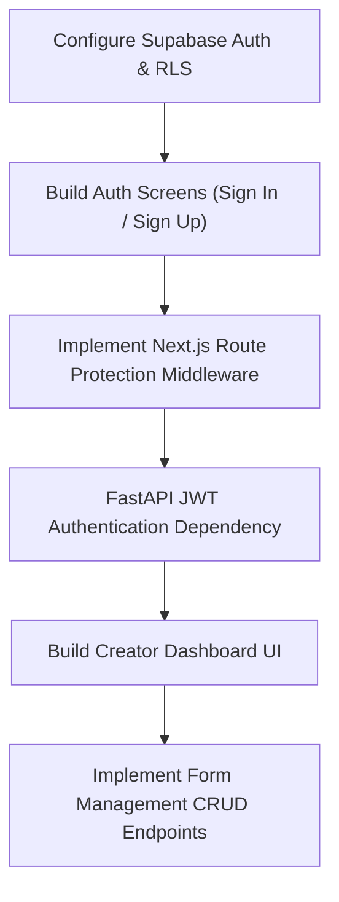

# Phase 2: Authentication & Creator Dashboard

---

## 1. Concepts Introduced in This Phase

### 1.1 JSON Web Tokens (JWT) & Stateless Authentication
- **Concept:** Stateless session management where user identity and claims are cryptographically signed into a compact token.
- **Application:** When a user logs in via Supabase Auth, they receive an access token (short-lived JWT) and a refresh token. The client includes this JWT in the `Authorization: Bearer <token>` header for requests to both Supabase and the Python backend, removing the need for server-side session stores.

### 1.2 OAuth 2.0 & Federated Social Identity
- **Concept:** Delegating identity verification to trusted third-party providers (e.g., Google, GitHub) without handling user passwords directly.
- **Application:** Supabase Auth handles the OAuth authorization code exchange, verifies redirect URIs, and automatically provisions or matches user records in `profiles`.

### 1.3 Edge Route Protection via Next.js Middleware
- **Concept:** Inspecting incoming requests at the network edge before rendering any React components or serving server-rendered HTML.
- **Application:** Next.js middleware checks the validity of the Supabase session cookie. If missing or expired, requests targeting `/(dashboard)` are redirected to `/login`, preventing unauthenticated page flashes.

### 1.4 PostgreSQL Row-Level Security (RLS) Policies
- **Concept:** Fine-grained database access policies evaluated by PostgreSQL for every query execution.
- **Application:** Policies such as:
  - *Read Forms:* `USING (auth.uid() = creator_id)`
  - *Insert Forms:* `WITH CHECK (auth.uid() = creator_id)`
  This guarantees strict tenant isolation at the database layer, ensuring creators can never view or manipulate forms created by others.

### 1.5 Optimistic UI Updates
- **Concept:** Reflecting the expected outcome of user actions in the interface immediately before receiving server confirmation.
- **Application:** When a creator duplicates, renames, or deletes a form, the dashboard UI updates instantly, rolling back gracefully if the API returns an error.

---

## 2. Detailed Implementation Plan

### Step 1: Supabase Auth & Security Policies
- Enable Email/Password authentication in the Supabase console.
- Configure OAuth providers (Google, GitHub) with proper redirect callbacks.
- Create automated database triggers: on new user signup in `auth.users`, automatically create an entry in the `profiles` table.
- Enforce RLS policies on the `forms` table:
  - `SELECT`: Only where `creator_id = auth.uid()`
  - `INSERT`: Only where `creator_id = auth.uid()`
  - `UPDATE`: Only where `creator_id = auth.uid()`
  - `DELETE`: Only where `creator_id = auth.uid()`

### Step 2: Next.js Authentication Pages & Flow
- Implement auth screens:
  - `/login`: Email + password form and social login buttons.
  - `/register`: User onboarding with password strength validation.
  - `/forgot-password` & `/reset-password`: Recovery flows via magic link or reset token.
- Implement an authentication provider or state listener using the Supabase client SDK to track active session state across component trees.

### Step 3: Next.js Middleware & Protected Routes
- Set up `middleware.ts` at the root of the Next.js project.
- Implement cookie extraction and session refresh logic using Supabase SSR helpers.
- Define routing rules:
  - Authenticated users attempting to visit `/login` or `/register` are redirected to `/dashboard`.
  - Unauthenticated users attempting to access `/dashboard/*` or `/editor/*` are redirected to `/login`.

### Step 4: Python Backend Authentication Dependency
- Create a FastAPI security dependency using `HTTPBearer`.
- Implement JWT token decoding and signature validation using Supabase's public JWT secret.
- Extract the user's UUID from the token payload and inject a `CurrentCreator` entity into downstream route handlers.
- Return standard `401 Unauthorized` for missing, expired, or tampered tokens.

### Step 5: Creator Dashboard Interface
- Develop dashboard layout with top navigation (user profile avatar, sign out button, theme toggle) and main content area.
- Implement Form Cards / Grid View:
  - Form Title and Description preview.
  - Status Badge (`Draft` in yellow, `Published` in green, `Closed` in gray).
  - Total response counter with real-time freshness indicator.
  - Last edited timestamp.
  - Dropdown action menu (Edit, Duplicate, Share, Close, Delete).
- Implement Search and Filtering bar:
  - Text search by form title.
  - Status filter tabs (`All`, `Published`, `Drafts`, `Closed`).
  - Sort by recently updated, oldest, or most responses.

### Step 6: Form CRUD Operations
- Implement backend API endpoints (and matching frontend mutations):
  - `POST /api/v1/forms`: Create a new blank form with default title and placeholder slug.
  - `GET /api/v1/forms`: Fetch all forms owned by the authenticated creator.
  - `PATCH /api/v1/forms/{form_id}`: Update title, description, or status.
  - `POST /api/v1/forms/{form_id}/duplicate`: Clone form record and all associated questions.
  - `DELETE /api/v1/forms/{form_id}`: Soft delete or cascade delete form and associated responses.

---

## 3. Deliverables & Verification Criteria

| Deliverable | Success Criteria |
|---|---|
| **User Sign-Up & Sign-In** | User can register via email/password or OAuth, receive session tokens, and see their profile. |
| **Route Protection** | Direct URL navigation to `/dashboard` while logged out reliably redirects to `/login`. |
| **Backend Guard** | Calling protected FastAPI endpoints without a valid bearer token returns `401 Unauthorized`. |
| **Dashboard Listing** | Authenticated creators see only their own forms; dashboard reflects newly created forms. |
| **Form CRUD** | Creator can create a new form, rename it, duplicate it, and delete it with immediate UI feedback. |

