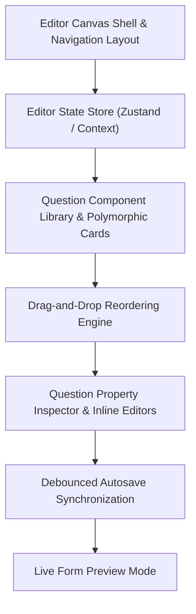

# Phase 3: Interactive Form Builder Engine

---

## 1. Concepts Introduced in This Phase

### 1.1 Schema-Driven UI Generation
- **Concept:** Decoupling form structure from static UI code by modeling forms as dynamic, structured JSON documents.
- **Application:** The canvas doesn't render hardcoded HTML inputs; instead, an array of question definitions dynamically determines what inputs, validation attributes, labels, and choice options appear on screen.

### 1.2 Unidirectional Data Flow & Editor State Management
- **Concept:** Maintaining a single source of truth for the active form editor state with deterministic mutation dispatchers.
- **Application:** An editor store (e.g., Zustand or React Context) manages:
  - Form metadata (title, description, settings).
  - The ordered question array.
  - Active / selected question focus.
  - Dirty states (unsaved edits) and undo/redo action history.

### 1.3 Debouncing & Background Autosaving
- **Concept:** Throttling rapid user inputs (e.g., typing question labels or modifying options) to avoid flooding the server with API calls.
- **Application:** Changes update the client state immediately. A debounce timer (e.g., 800ms) collects modifications before sending a background patch request to the FastAPI backend, while displaying real-time visual feedback ("Saving...", "All changes saved").

### 1.4 Drag-and-Drop Pointer Mechanics & Reordering Algorithms
- **Concept:** Accessible, pointer-based manipulation of list items with collision detection and smooth visual displacement.
- **Application:** Users can grab a reorder handle on any question card, drag it vertically across the canvas, and drop it. The editor calculates new positional indices (`order_index`) and updates the question array.

### 1.5 Polymorphic Component Architecture
- **Concept:** Designing a unified container component that swaps out its interior body dynamically based on a `type` discriminator.
- **Application:** A standard `QuestionCard` component provides uniform controls (selection border, required toggle, duplicate button, delete button) while dynamically delegating the input configuration to specific child components (`ShortTextConfig`, `ChoiceListConfig`, `RatingScaleConfig`, etc.).

---

## 2. Detailed Implementation Plan

### Step 1: Editor Shell & Navigation Layout
- Build the editor header:
  - Form Title (inline editable with automatic slug synchronization).
  - Navigation tabs: `Questions` (Canvas), `Responses` (Analytics & Data), and `Settings` (Form parameters).
  - Save status indicator (Cloud icon with "Saved" / "Saving..." states).
  - Action buttons: "Preview" (opens simulated respondent view) and "Publish" / "Share" modal.
- Layout division:
  - Floating or sticky question-type palette (quick-add buttons for Short Text, Multiple Choice, etc.).
  - Central scrollable canvas with responsive margin gutters.

### Step 2: Editor State Store Architecture
- Define the state schema:
  - `formId`, `title`, `description`, `status`.
  - `questions`: Array of question entities with unique `field_key`, `type`, `label`, `description`, `order_index`, `validation_rules`, and `options`.
  - `activeQuestionId`: Currently focused card.
  - `isDirty`: Flag indicating unsaved client-side changes.
  - `saveStatus`: State indicator (`idle`, `saving`, `saved`, `error`).
- Implement mutation actions:
  - `addQuestion(type, insertAtIndex)`
  - `updateQuestion(id, partialUpdates)`
  - `reorderQuestions(startIndex, endIndex)`
  - `duplicateQuestion(id)`
  - `deleteQuestion(id)`

### Step 3: Question Component Library
Implement configuration components for all question variants:
- **Short Answer:** Single-line preview with configurable placeholder and character limit rules.
- **Paragraph:** Multi-line text area preview with min/max length rules.
- **Multiple Choice:** Radio button list with inline option addition, removal, and "Add 'Other'" toggle.
- **Checkboxes:** Multi-select list with validation for min/max allowable selections.
- **Dropdown:** Select box with option management list.
- **Linear Scale / Rating:** Range selector (e.g., 1–5 or 1–10) with custom minimum and maximum text labels.
- **Date & Time:** Date picker preview with optional time toggle.
- **File Upload:** Upload zone preview with allowed MIME-type pickers and maximum file size constraints.

### Step 4: Drag-and-Drop Reordering
- Integrate pointer event sensors supporting both mouse and touch interfaces.
- Wrap question cards in draggable containers with visible drag handles.
- Implement drop indicators and smooth transition animations during reordering.
- Recalculate sequential `order_index` values across the entire questions array on drop release.

### Step 5: Question Property Inspector
- Develop contextual card controls:
  - Required toggle switch.
  - Expandable description/help text field.
  - Validation rules modal (regex pattern matching, numeric ranges).
  - Duplicate button (creates an exact replica with a new unique `field_key` directly below the source card).
  - Delete button with undo notification snackbar.

### Step 6: Autosave Synchronization Service
- Implement debounced synchronization to the Python backend:
  - Endpoint: `PUT /api/v1/forms/{form_id}/builder`
  - Request body receives the full updated form definition and question collection.
  - Backend transaction: updates form metadata, performs bulk upsert on `form_questions`, and deletes removed question records atomically.
- Handle edge cases: offline detection, network retry with exponential backoff, and dirty-state warning if the user attempts to close the browser tab during active saving.

### Step 7: Live Preview Mode
- Provide a responsive preview modal allowing the creator to test the form in Desktop, Tablet, and Mobile viewport frames.
- Render the exact respondent UI without submitting data to the database, verifying tab order, validation prompts, and layout aesthetics.

---

## 3. Deliverables & Verification Criteria

| Deliverable | Success Criteria |
|---|---|
| **Question Library** | All 8 question types can be added to the canvas and customized. |
| **Drag & Drop** | Cards can be dragged vertically, reordered smoothly, and retain their updated sequence. |
| **Inline Editing** | Title, descriptions, labels, and choice options can be modified directly on the canvas. |
| **Autosave Pipeline** | Changes made in the editor trigger a debounced save; refreshing the page restores the exact state. |
| **Live Preview** | Clicking "Preview" opens an accurate simulated view of the public respondent experience. |

