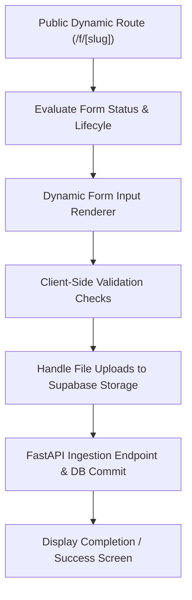

# Phase 4: Public Form Viewer & Submission Engine

---

## 1. Concepts Introduced in This Phase

### 1.1 Server-Side Rendering (SSR) & Dynamic Routing
- **Concept:** Generating HTML on the server for each unique request URL (`/f/[slug]`) before transmitting it over the wire.
- **Application:** Public forms achieve sub-second First Contentful Paint (FCP) across mobile and desktop devices. OpenGraph social preview tags (title, description, banner preview) are dynamically injected for links shared on messaging platforms or social media.

### 1.2 Dual-Layer Validation Strategy (Defense in Depth)
- **Concept:** Providing immediate, non-intrusive feedback to the user on the client while treating the client as untrusted on the server.
- **Application:**
  - *Client-Side:* Next.js checks required fields, email syntax, character bounds, and file sizes before sending data, preventing unnecessary network calls.
  - *Server-Side:* FastAPI runs authoritative validation using Pydantic schemas against the database question rules, ensuring payload integrity even if client scripts are bypassed or manipulated.

### 1.3 Secure File Ingestion & Storage Policies
- **Concept:** Handling respondent file attachments securely without burdening the application server with large multi-part binary streams.
- **Application:** Respondent attachments are uploaded directly to Supabase Storage using scoped upload tokens or presigned paths, mapping the resulting secure URL to the answer payload in the database.

### 1.4 Form Lifecycle Gatekeeping
- **Concept:** Checking form availability rules before rendering or accepting any submission data.
- **Application:** The system evaluates whether:
  - The form status is `published` (not `draft` or `closed`).
  - The current timestamp is before the form's closing date (if set).
  - Total submissions have not exceeded the creator's configured maximum response quota.

### 1.5 Submission Idempotency & Rate Limiting
- **Concept:** Preventing accidental duplicate entries caused by network retries or repeated button clicks.
- **Application:** Unique client-generated submission tokens ensure a single submission attempt cannot create multiple database records, while IP-based rate limiting defends against automated spam.

---

## 2. Detailed Implementation Plan

### Step 1: Dynamic Route & Server-Side Fetching
- Define the public Next.js route: `app/(public)/f/[slug]/page.tsx`.
- Implement server-side data fetching to retrieve public form metadata and questions:
  - Verify that the form exists and status is `published`.
  - Fetch questions sorted strictly by `order_index`.
  - Inject metadata (title, description, cover image) into the HTML `<head>`.

### Step 2: Form Lifecycle & Gatekeeping Screens
- Implement conditional view states before rendering the form:
  - **Form Not Found:** Friendly 404 screen.
  - **Form Closed / Inactive:** Notice stating "This form is no longer accepting responses" with an optional message from the creator.
  - **Response Limit Reached:** Notice informing the user that the response quota has been fulfilled.

### Step 3: Dynamic Form Input Renderer
- Build the dynamic responder form component:
  - Header banner and branding colors dynamically applied from form settings.
  - Form title and markdown-enabled description.
  - Sequentially rendered question components mapping to the schema types:
    - Text inputs with appropriate virtual keyboard layouts on mobile (`email`, `tel`, `number`, `url`).
    - Accessible radio button groups and checkbox clusters with clear focus indicators.
    - Custom styled select dropdowns.
    - Touch-friendly linear rating scale buttons.
    - Drag-and-drop file upload zones with visual file size and type constraints.

### Step 4: Client-Side Validation Engine
- Implement state tracking for all form field inputs.
- Validate on blur (field exit) and on submit:
  - Check that all `is_required` questions contain answers.
  - Validate minimum and maximum lengths for text fields.
  - Check selection limits for checkboxes (e.g., "Select at most 2 options").
  - Enforce file constraints (file types matching allowed MIME extensions, size under limit).
- Render accessible, high-contrast inline error messages beneath failing inputs and auto-scroll to the first invalid field.

### Step 5: Secure File Attachment Pipeline
- When a respondent attaches a file:
  - Perform client-side extension and byte-size checks.
  - Request a short-lived upload path from the backend or Supabase Storage.
  - Stream the file directly to the `respondent-uploads` bucket with unique, non-colliding file paths.
  - Store the resulting storage file reference in the submission payload.

### Step 6: FastAPI Ingestion Endpoint & Atomic Persistence
- Implement the submission API endpoint:
  - `POST /api/v1/forms/{slug}/submit`
- Backend validation workflow:
  1. Retrieve active form and question schema by `slug`.
  2. Verify form status is `published` and not expired.
  3. Validate incoming answer payload against question rules.
  4. Open a database transaction:
     - Insert record into `form_responses`.
     - Bulk insert answers into `form_answers` referencing the response ID.
     - Increment the cached response counter on `forms`.
  5. Commit transaction and return confirmation payload with a generated submission receipt ID.

### Step 7: Completion Experience
- Render a customizable success view:
  - Confirmation checkmark animation.
  - Creator's custom thank-you message (e.g., "Your response has been recorded.").
  - "Submit another response" button (displayed only if permitted in form settings).

---

## 3. Deliverables & Verification Criteria

| Deliverable | Success Criteria |
|---|---|
| **Public Form Route** | Navigating to `/f/[slug]` renders the published form with all questions in correct order. |
| **Status Gatekeeping** | Draft or closed forms display the appropriate closed notice rather than the form inputs. |
| **Client Validation** | Submitting with empty required fields halts submission and displays inline error messages. |
| **Submission Ingestion** | Submitting a valid form creates records in `form_responses` and `form_answers` in Supabase. |
| **File Uploads** | Respondent file attachments appear securely in Supabase Storage with references stored in answers. |
| **Success State** | Respondent sees the customizable confirmation screen upon successful submission. |

