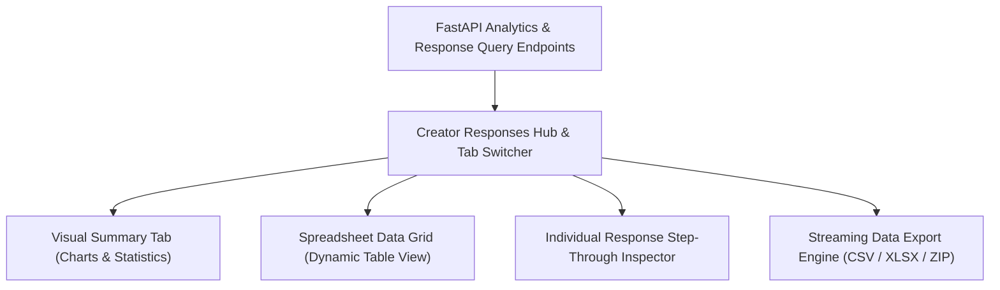

# Phase 5: Response Management & Analytics Engine

---

## 1. Concepts Introduced in This Phase

### 1.1 Relational Aggregations & Statistical Calculations
- **Concept:** Transforming raw individual submission records into aggregated statistical metrics using database queries and backend calculations.
- **Application:** Rather than pulling all raw rows to the frontend for processing, the Python backend aggregates answer frequencies for choice-based questions (count and percentage per option) and computes statistical metrics (mean, median, range) for linear scale and rating questions.

### 1.2 Virtualized Data Grids for High-Volume Tables
- **Concept:** Rendering only the DOM nodes currently visible within the viewport window, even if the dataset contains thousands of rows.
- **Application:** The response table (spreadsheet view) utilizes virtualization and server-driven pagination, ensuring that forms with thousands of submissions remain performant and responsive without memory lag.

### 1.3 Data Visualization & Information Hierarchy
- **Concept:** Selecting visual charting paradigms that accurately reflect the underlying data types.
- **Application:**
  - *Categorical Data (Multiple Choice, Dropdown):* Donut / Pie charts for single select; horizontal bar charts for multi-select checkboxes.
  - *Quantitative Data (Rating Scale):* Histograms showing distribution curves alongside computed average scores.
  - *Qualitative Data (Short Answer, Paragraph):* Searchable, paginated card lists with text filtering.

### 1.4 Memory-Efficient Streaming Data Exports
- **Concept:** Generating and streaming large file exports (CSV, XLSX) as chunked byte streams rather than compiling entire datasets in server memory.
- **Application:** The FastAPI export service streams generated CSV rows directly to the HTTP response buffer, allowing creators to download exports of massive datasets without risking server Out-Of-Memory (OOM) crashes.

---

## 2. Detailed Implementation Plan

### Step 1: Backend Analytics & Response Endpoints
- Implement FastAPI query routes:
  - `GET /api/v1/forms/{id}/responses/summary`: Returns pre-aggregated question statistics, option distributions, and submission timeline metrics.
  - `GET /api/v1/forms/{id}/responses`: Returns paginated submission rows with filtering and sorting support.
  - `GET /api/v1/forms/{id}/responses/{response_id}`: Returns the full answer payload for a single submission.
  - `DELETE /api/v1/forms/{id}/responses/{response_id}`: Deletes a specific submission and cascades to associated answers.
  - `DELETE /api/v1/forms/{id}/responses`: Deletes all submissions (reset responses).

### Step 2: Response Hub Navigation & Controls
- Build the `Responses` tab layout within the form editor workspace:
  - Top control bar: Total response count badge.
  - "Accepting Responses" toggle switch (immediately updates form status in DB).
  - Sub-navigation tabs:
    - `Summary`: Visual chart-based overview.
    - `Question`: Question-by-question breakdown.
    - `Individual`: Step-by-step submission browser.
    - `Spreadsheet`: Full data grid view.
  - Actions menu: "Download CSV", "Download Excel", and "Delete all responses".

### Step 3: Visual Analytics Tab (Summary View)
- Develop modular chart widgets for each question type:
  - **Choice Questions:** Interactive pie or bar charts showing option label, total votes, and percentage of total responses.
  - **Rating Scale Questions:** Bar chart displaying response counts for each rating value (1–5 or 1–10) with an average score callout badge.
  - **Text Questions:** Paginated card list showing individual text answers, timestamp of entry, and search filter input.
  - **File Upload Questions:** Gallery list showing uploaded file names, MIME types, file sizes, and secure download links.

### Step 4: Interactive Data Table (Spreadsheet View)
- Build dynamic data grid:
  - Columns dynamically generated from all active form questions in sequential order, plus metadata columns (`Submission ID`, `Submitted At`).
  - Rows represent individual respondent submissions.
  - Column features:
    - Sort ascending / descending by submission time or answer values.
    - Text search filtering across columns.
    - Column resizing and sticky left column for submission timestamp.
  - Row actions: Click to view details drawer or delete submission.

### Step 5: Individual Response Inspector
- Build an individual response viewer replicating the visual layout of the original form:
  - Top navigation bar: "Response [X] of [Total]" with previous/next pagination arrows.
  - Displays each question with the exact answer filled out by the respondent.
  - Action buttons: "Delete this response" (with confirmation dialog) and "Print / Save as PDF".

### Step 6: Data Export Pipeline
- Implement export endpoints in Python:
  - `GET /api/v1/forms/{id}/export/csv`: Streams comma-separated values with UTF-8 encoding support.
  - `GET /api/v1/forms/{id}/export/xlsx`: Streams an formatted Excel spreadsheet with auto-sized column widths.
  - `GET /api/v1/forms/{id}/export/files`: For forms with file uploads, compiles attachments into a downloadable ZIP archive.

---

## 3. Deliverables & Verification Criteria

| Deliverable | Success Criteria |
|---|---|
| **Summary Dashboard** | Summary tab displays correct charts and response distributions matching database records. |
| **Data Table** | Spreadsheet view renders all submissions with working pagination, column sorting, and search. |
| **Individual View** | Creator can flip through responses one by one and view exact answers provided. |
| **Delete Actions** | Deleting a single submission updates the total counter and removes the record from both views. |
| **CSV/XLSX Export** | Clicking "Export CSV" or "Export Excel" downloads a valid spreadsheet with all questions and answers. |
| **Access Control** | Users cannot view responses or analytics for forms they do not own. |

