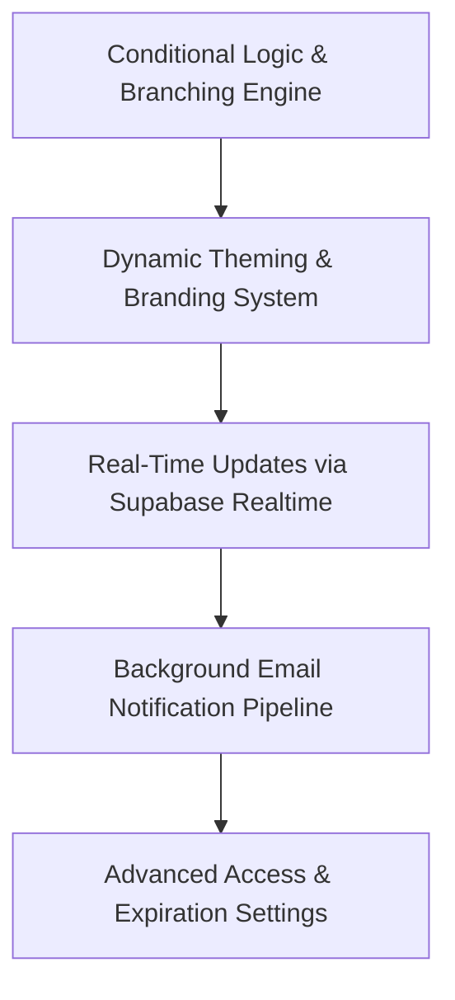

# Phase 6: Advanced Capabilities & Refinement

---

## 1. Concepts Introduced in This Phase

### 1.1 Directed Acyclic Graphs (DAG) for Conditional Logic & Skip Branching
- **Concept:** Modeling dynamic questionnaire paths as a directed graph without cycles, where visibility or progression to subsequent questions depends on choices made in earlier fields.
- **Application:** If a respondent selects "Other" or "Yes", conditional rules evaluate client-side to show targeted follow-up questions or jump directly to a designated section, while automatically validating that rules cannot create circular loops.

### 1.2 Runtime CSS Variables & Dynamic Theming
- **Concept:** Modifying the aesthetic appearance of an application dynamically at runtime using CSS Custom Properties (`var(--primary-color)`).
- **Application:** Form creators can select custom brand colors, font families, and upload custom header banners. The public form dynamically injects these properties into the root container styles without requiring re-compilation of Tailwind CSS.

### 1.3 Push-Based Architectures via Supabase Realtime
- **Concept:** Replacing repeated polling with persistent WebSocket connections that broadcast database Change-Data-Capture (CDC) events.
- **Application:** While a creator views the dashboard or response table, Supabase Realtime pushes notifications for incoming submissions directly to the client, automatically incrementing counters and appending new rows to the data grid in real time.

### 1.4 Asynchronous Background Tasks & Notification Pipelines
- **Concept:** Offloading non-blocking secondary side-effects (such as sending email confirmations or triggering webhooks) from the critical HTTP response path.
- **Application:** When a respondent submits a form, the response is recorded and acknowledged immediately. An asynchronous background task (e.g., FastAPI `BackgroundTasks` or Supabase Edge Functions) then triggers email alerts to the form owner and sends a receipt copy to the respondent (if requested).

---

## 2. Detailed Implementation Plan

### Step 1: Conditional Branching Engine
- **Data Model Extension:**
  - Add `logic_rules` array to the `form_questions` JSON configuration.
  - Rule structure: Condition (`field_key`, `operator` like `equals`/`not_equals`, `value`) and Action (`show_question`, `hide_question`, `jump_to_section`).
- **Builder Interface:**
  - Logic drawer on question cards: "If answer to [Question A] equals [Option 1], then show [Question B]".
  - Cycle detection check ensuring conditional rules do not create infinite dependency loops.
- **Respondent Form Evaluation:**
  - Client-side reactive rules engine evaluating visible fields on every input state change.
  - Hidden questions automatically clear their stored answers before submission to prevent stale data.

### Step 2: Dynamic Theming & Branding System
- **Customization Settings in Builder:**
  - Primary accent color picker (with accessible contrast ratio warnings).
  - Background surface tint selector.
  - Header banner image uploader (stores image in `form-assets` bucket and previews in canvas).
  - Font family selector (Clean Sans, Serif, Monospace).
- **Public Form Application:**
  - Injected CSS variable block on the public form root container:
    - `--form-accent: #3b82f6`
    - `--form-font: 'Inter', sans-serif`
  - Responsive banner display with cover-fit aspect ratio handling.

### Step 3: Real-Time Submissions via Supabase Realtime
- Enable replication on `form_responses` and `forms` tables in Supabase.
- Integrate Realtime subscription hooks in the Next.js creator workspace:
  - When viewing the Dashboard: live counter badges pulse and update on incoming submissions.
  - When viewing the Response Data Table: new submission rows smoothly highlight and append to the grid without requiring page refreshes.

### Step 4: Asynchronous Notification Pipeline
- Configure email service provider integration (e.g., Resend, SendGrid, or AWS SES via FastAPI or Supabase Edge Functions).
- Create email notification workflows:
  - **Creator Notification:** Immediate notification email containing submission summary and link to view details in the dashboard.
  - **Respondent Receipt:** Optional copy of answers sent to the respondent's submitted email address.
- Implement delivery failure handling and unsubscribe/mute preferences in form settings.

### Step 5: Advanced Access & Lifecycle Settings
- **Password Protection:** Optional password prompt required before the public form is displayed.
- **Single Submission Limit:** Enforce one response per authenticated user or browser fingerprint.
- **Scheduled Expiration:** Set specific date and time for automatic form closing.
- **Custom URL Slug:** Allow creators to define memorable vanity slugs (e.g., `/f/annual-survey-2026`).

---

## 3. Deliverables & Verification Criteria

| Deliverable | Success Criteria |
|---|---|
| **Conditional Logic** | Questions show or hide dynamically based on previous choices; hidden inputs do not submit data. |
| **Custom Theming** | Changing colors and uploading a banner image in the builder accurately reflects on the public form. |
| **Real-Time Feed** | Submitting a form in one browser window updates the response count live in an open dashboard window. |
| **Email Alerts** | Submissions reliably trigger notification emails containing submission summary details. |
| **Advanced Settings** | Forms configured with an expiration date or submission cap close automatically when thresholds are reached. |

