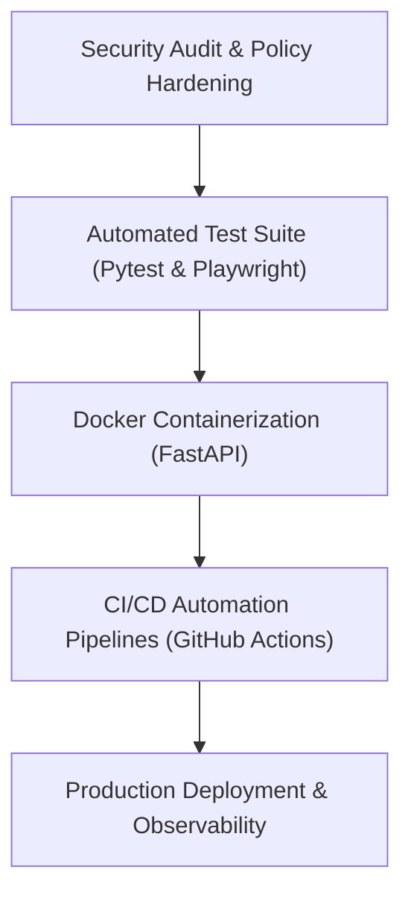

# Phase 7: Security, Testing & Production Deployment

---

## 1. Concepts Introduced in This Phase

### 1.1 Defense in Depth & Zero Trust Data Isolation
- **Concept:** Layering independent security barriers so that a breach or vulnerability in one layer (e.g., frontend script or API endpoint) is caught and neutralized by the underlying layer (database Row-Level Security).
- **Application:** Even if a malicious user crafts an API request attempting to fetch another user's form submissions, PostgreSQL's RLS engine rejects the query because the requesting session token does not match the form's `creator_id`.

### 1.2 OWASP Top 10 Protections for Form Systems
- **Concept:** Mitigating the most critical web application security risks defined by the Open Worldwide Application Security Project.
- **Application:**
  - *Broken Object-Level Authorization (BOLA):* Strict ownership verification on every form and response endpoint.
  - *Cross-Site Scripting (XSS):* Sanitizing all creator-defined question labels and markdown descriptions before rendering on the public form.
  - *Denial of Service (DoS):* Enforcing token-bucket rate limits on public submission endpoints to throttle automated submission bots.
  - *Unrestricted File Upload:* Validating magic byte signatures and file extensions on all respondent attachments to prevent executable uploads.

### 1.3 The Automated Testing Pyramid
- **Concept:** Organizing automated test suites across three distinct layers to balance speed, maintenance cost, and confidence.
- **Application:**
  - *Unit Tests (Base):* Fast, isolated tests for schema validation, Pydantic models, and utility calculations.
  - *Integration Tests (Middle):* Testing FastAPI endpoints against a live test database instance to verify database queries and transaction rollbacks.
  - *End-to-End Tests (Peak):* Playwright browser tests simulating full user journeys (e.g., creator builds a form, opens the public link in an incognito session, submits data, and verifies the response table updates).

### 1.4 Containerization & Immutable Deployment
- **Concept:** Encapsulating an application and all its runtime dependencies into a lightweight, standalone container image.
- **Application:** The Python FastAPI application is packaged using multi-stage Docker builds, ensuring identical execution behavior across local development, staging, and production environments.

### 1.5 Edge Delivery & Global Distribution
- **Concept:** Serving assets and pre-rendered pages from globally distributed data centers close to the user, backed by scalable backend services.
- **Application:** Next.js is deployed to edge networks (e.g., Vercel) for rapid global delivery of public forms, while the containerized FastAPI backend scales horizontally on managed container platforms (e.g., Google Cloud Run, Render, or Railway).

---

## 2. Detailed Implementation Plan

### Step 1: Security Audit & Policy Hardening
- **Database Row-Level Security Audit:**
  - Run adversarial tests simulating unauthenticated requests and cross-account access attempts.
  - Verify that public users can only write to `form_responses` and `form_answers` when a form is published and active.
- **API Hardening:**
  - Enforce CORS policies restricted strictly to the production frontend domain.
  - Implement IP-based and token-based rate limiting on public submission routes.
  - Configure HTTP security headers: `Strict-Transport-Security`, `X-Content-Type-Options`, `X-Frame-Options`, and `Content-Security-Policy`.
- **Upload Sanitization:**
  - Enforce byte-size caps and strict MIME-type allowlists on the `respondent-uploads` Supabase Storage bucket.

### Step 2: Automated Testing Implementation
- **Backend Test Suite (Pytest):**
  - Schema tests: Verify that invalid question types and malformed answers fail Pydantic validation.
  - Endpoint tests: Verify authentication guards, form CRUD operations, and response export generation.
  - Transaction tests: Ensure database rollback occurs if an error happens midway through recording answers.
- **Frontend Component Tests (React Testing Library):**
  - Verify that question components render correct inputs and invoke validation callbacks on empty required fields.
- **End-to-End Tests (Playwright):**
  - **Journey 1:** Creator logs in -> Creates a new form -> Adds text and choice questions -> Publishes form.
  - **Journey 2:** Anonymous user navigates to public form -> Fills out questions -> Uploads test file -> Submits form -> Sees confirmation.
  - **Journey 3:** Creator logs back in -> Opens response dashboard -> Verifies new submission appears in data table -> Downloads CSV export.

### Step 3: Containerization & Dockerfile Setup
- Create a multi-stage `Dockerfile` for the FastAPI backend:
  - Base builder stage: Installs dependencies and compiles native wheels.
  - Production runtime stage: Minimal Linux base, non-root system user, environment variable injection, and `uvicorn` production process manager.
- Create `docker-compose.yml` for running local full-stack integration environments with a single command.

### Step 4: CI/CD Pipeline Automation (GitHub Actions)
- Build continuous integration workflows:
  - **Lint & Typecheck:** Run `ruff` / `black` / `mypy` on Python code and `eslint` / `tsc` on TypeScript code on every pull request.
  - **Automated Tests:** Execute Pytest suite and frontend component tests on every push.
  - **E2E Smoke Tests:** Execute Playwright headless browser tests against preview deployment URLs.
- Build continuous deployment workflows:
  - Deploy backend container to container registry and trigger rolling release upon merge to `main`.
  - Automatically deploy Next.js frontend to production environment.

### Step 5: Production Deployment & Observability
- **Frontend Deployment (Vercel):**
  - Configure production domain with automated SSL.
  - Set production environment variables (`NEXT_PUBLIC_SUPABASE_URL`, `NEXT_PUBLIC_SUPABASE_ANON_KEY`, `NEXT_PUBLIC_BACKEND_API_URL`).
- **Backend Deployment (Cloud Run / Render / Railway):**
  - Configure horizontal auto-scaling rules based on CPU and request concurrency.
  - Inject production secrets via environment secret managers.
- **Observability & Error Monitoring:**
  - Integrate error tracking (e.g., Sentry) across both Next.js and FastAPI to monitor unhandled exceptions in production.
  - Set up structured JSON logging in FastAPI for log aggregation and auditing.

---

## 3. Deliverables & Verification Criteria

| Deliverable | Success Criteria |
|---|---|
| **Security Audit** | RLS verified; unauthorized queries to foreign forms or responses receive 403/404 errors. |
| **Rate Limiting** | Rapid automated requests to `/submit` are throttled with standard `429 Too Many Requests`. |
| **Automated Tests** | Backend Pytest and frontend test suites pass with zero failures in CI pipeline. |
| **E2E Verification** | Playwright test completes the entire creator-to-respondent journey in a headless browser. |
| **Container Build** | FastAPI Docker image compiles cleanly without root privileges and passes container health checks. |
| **Production Launch** | Live frontend and backend applications communicate seamlessly over production HTTPS domains. |

